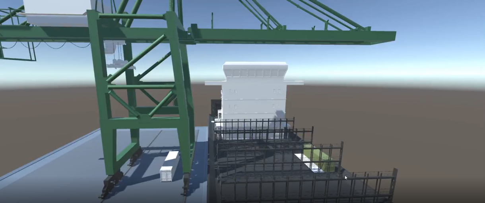

**Built with:** Unity3D · ML-Agents · PPO · SAC

## Overview

This is a focused offshoot of the [RL Quay Crane](rl_crane.qmd) project, built in the same Unity3D simulator and trained with the same ML-Agents setup.

Where that project asked whether reinforcement learning could handle the full job of a quay crane operator, this one narrowed the question to a single, unglamorous control problem that costs real time on every move: skew.

::: {.column-margin}
**Key Insight:** Settle time dropped from **27 seconds** to **6 seconds** — a ~78% reduction.
:::

## The Problem

A spreader hanging from a set of hoist ropes is a suspended mass with very little to damp it. Disturb it and it keeps moving long after the input that caused it has stopped. Skew — rotation of the spreader around its vertical axis — is the most awkward of those motions, because a skewed spreader cannot be landed. Twistlocks only engage when the spreader is square to the container beneath it.

The result is dead time. The operator either waits for the motion to bleed off, or spends attention actively fighting it — on every single move, on a machine whose entire value is measured in moves per hour.

In the simulation, an undamped skew disturbance took **27 seconds** to settle to within landing tolerance. That was the baseline to beat.

## Approach

The environment was cut down to just the skew axis: no container stacks, no safety curriculum, no positioning targets. The agent observed the spreader's orientation and angular velocity and acted on the skew control, and the reward was shaped around two things — how much skew was left, and how long it took to get rid of it. Anything that reached a stable, landable position faster scored better.

Stripping the problem down this far had a practical benefit. The full crane environment was expensive to train on limited hardware; a single-axis task trained fast enough to iterate on reward shaping properly instead of guessing.

## Result

The trained controller brought the spreader from a skew disturbance to a landable position in **6 seconds**, against a **27-second** baseline — roughly a 78% reduction in settle time, and it did it without the overshoot-and-correct pattern that a naive damping strategy falls into.

## Conclusion

The wider quay crane project answered a big question — can RL do this job at all — with a qualified yes. This one answered a smaller question with a much harder number: on a narrow, well-defined control problem, a learned controller measurably beat waiting for physics.

That distinction turned out to matter. Full autonomy is a research programme; shaving twenty seconds off a repeated motion is an engineering change with an obvious payback. Most of the value in automating heavy equipment sits in problems shaped like the second one — small, specific, and hiding in the gaps between the interesting parts of the job.
