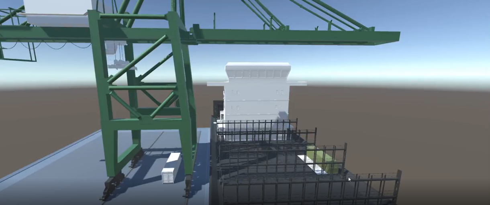

**Built with:** Unity3D · YOLOv11 · Python · PyTorch

::: {.callout-note appearance="simple"}
Ongoing personal research. This page describes work in progress, not a finished result.
:::

## Overview

Every control idea I have looked at for quay cranes eventually runs into the same wall: the machine does not know where its own spreader is, in any form a model can use. Encoder and PLC data tell you where the trolley and hoist are commanded to be. They do not tell you what the spreader is actually doing at the end of forty metres of rope, and they say nothing at all about the container underneath it.

A camera does. This project is about turning a camera view into that missing state — detecting and segmenting the spreader from vision alone.

::: {.column-margin}
**Why this matters:** Vision is the cheapest sensor that can see the part of the machine that is hardest to instrument.
:::

## The Data Problem

Vision models need labelled data, and labelled imagery of a working spreader is not something you can go and collect. Terminal footage is operationally sensitive, the useful cases are the rare ones, and hand-labelling segmentation masks frame by frame is slow enough to kill a personal project before it starts.

So the data comes from a simulation instead. I built a new Unity3D environment — separate from the one behind the earlier [RL Quay Crane](rl_crane.qmd) and [skew stabilisation](rl_skew.qmd) work, and aimed at rendering rather than control — that produces camera imagery of the spreader together with its labels. The simulator knows exactly where every object is, so the bounding boxes and segmentation masks come out of the renderer as ground truth. No annotation pass, and no ceiling on how much data I can generate.

That also makes the awkward cases cheap. Skewed spreader, poor light, rain on the lens, an obstructed view, an unusual angle — all of them are a parameter change rather than a wait for the right day on the quay.

## Models

Two YOLOv11 heads on the same synthetic dataset:

- **Detection** — bounding boxes, for fast, coarse localisation of the spreader in frame.
- **Segmentation** — pixel masks, for the orientation and pose information a box cannot carry. A skewed spreader and a square one occupy nearly the same bounding box; their masks do not.

Running both is deliberate. The detection model sets the floor for what is achievable and is cheap enough to run in real time; the segmentation model is where the actually useful signal lives, and is worth the extra cost only if it earns it.

## Where It Stands

Training and evaluation on synthetic data are underway. The open question — the one that decides whether any of this is more than a nice demo — is transfer: a model trained entirely in a game engine has to survive contact with a real camera on a real crane in real weather. That gap, not the architecture, is the actual research problem here.

## Why I'm Building It

This closes a loop that has been open since 2021. The reinforcement learning work assumed a perfect view of the world, because in a simulator you get one for free. A real crane does not have that, and no amount of reward shaping fixes a missing observation.

Perception is the part that has to exist first. Everything else — skew damping, assisted landing, full automation — is downstream of a machine that can see what it is doing.
